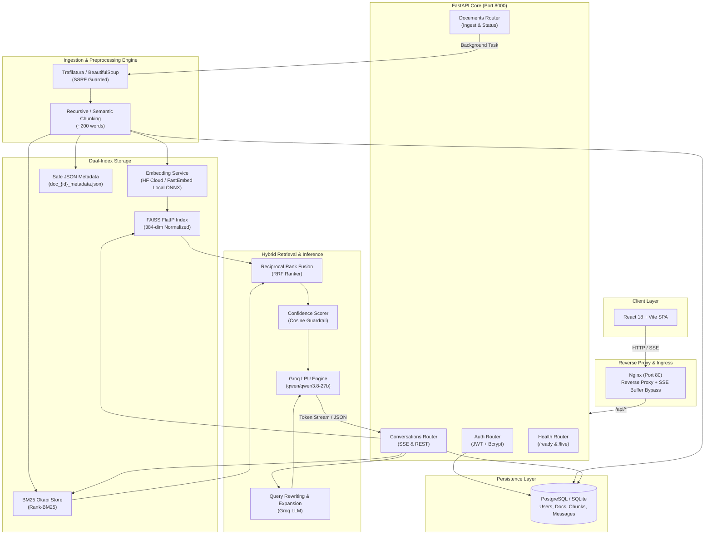

# WebRAG – Production-Grade Webpage Q&A Pipeline

[](https://www.python.org/)
[](https://fastapi.tiangolo.com/)
[](https://react.dev/)
[](https://groq.com/)
[](https://qdrant.github.io/fastembed/)
[](https://github.com/facebookresearch/faiss)
[](https://www.docker.com/)
[](https://github.com/pgvector/pgvector)
[](https://docs.pytest.org/)

**WebRAG** is a production-hardened, end-to-end Retrieval-Augmented Generation (RAG) platform that enables users to turn any webpage into an interactive, cited conversational knowledge base.

Users supply a target URL; WebRAG fetches and sanitizes the content, splits it into semantic chunks, indexes it across dense and sparse retrievers, and delivers grounded, verifiable answers powered by Groq LLMs with real-time token streaming and citation tracking.

---

## 📑 Table of Contents

- [Key Capabilities & Innovations](#-key-capabilities--innovations)
- [System Architecture](#-system-architecture)
- [Tech Stack](#-tech-stack)
- [Repository Structure](#-repository-structure)
- [Quick Start Guide (Local Development)](#-quick-start-guide-local-development)
  - [Prerequisites](#prerequisites)
  - [1. Backend Setup](#1-backend-setup)
  - [2. Frontend Setup](#2-frontend-setup)
  - [3. Verify Development Setup](#3-verify-development-setup)
- [Production Deployment with Docker Compose](#-production-deployment-with-docker-compose)
- [Configuration & Environment Variables](#-configuration--environment-variables)
- [API Reference](#-api-reference)
  - [Authentication](#authentication)
  - [Document Ingestion](#document-ingestion)
  - [Conversations & SSE Streaming](#conversations--sse-streaming)
  - [System Health & Readiness](#system-health--readiness)
- [Testing & Quality Assurance](#-testing--quality-assurance)
- [Production Hardening & Design Decisions](#-production-hardening--design-decisions)
- [Troubleshooting & FAQs](#-troubleshooting--faqs)

---

## ⚡ Key Capabilities & Innovations

- **Hybrid Dense-Sparse Retrieval:**
  Combines **FAISS** vector search (dense semantic context) and **BM25** (sparse exact keyword matching) unified via **Reciprocal Rank Fusion (RRF)** and metadata-aware re-ranking.
- **Zero-Cost & Resilient Embedding Pipeline:**
  Supports Hugging Face Inference API with an automatic, seamless local **FastEmbed (ONNX)** fallback using `sentence-transformers/all-MiniLM-L6-v2` (384 dimensions). If external API credits expire (e.g. HTTP 402/403) or network drops, FastEmbed executes locally on CPU with zero GPU requirement and zero billable quota.
- **Server-Sent Events (SSE) Token Streaming:**
  Features low-latency token streaming over `text/event-stream` (`/api/conversations/{id}/messages/stream`), dispatching real-time pipeline status events (`expanding`, `retrieving`, `generating`, `done`) with Time-To-First-Token under 300ms.
- **Safe Persistence & Zero Arbitrary Code Execution:**
  Eliminated all Python `pickle` deserialization hazards. Index metadata and chunk stores are persisted cleanly as structured JSON (`doc_{id}_metadata.json`).
- **Confidence Scoring & Hallucination Guardrails:**
  Calculates cosine distance thresholds to assess retrieval relevance. Out-of-domain or unsupported questions are transparently rejected before the LLM generates misleading answers.
- **Multi-Stage Docker Orchestration:**
  Optimized container builds with CPU-only wheels, non-root user execution, automated schema migrations (`alembic upgrade head` in `entrypoint.sh`), and an **Nginx** reverse proxy disabling buffers for SSE streams.
- **Dual-Database Portability:**
  Ready out-of-the-box with **SQLite** for instant local testing and **PostgreSQL with pgvector** for multi-tenant production scale.

---

## 🏗️ System Architecture



---

## 🛠️ Tech Stack

| Domain | Technology / Library | Purpose |
| :--- | :--- | :--- |
| **Backend Framework** | [FastAPI](https://fastapi.tiangolo.com/) `0.141.1` | High-performance asynchronous API framework |
| **ASGI Server** | [Uvicorn](https://www.uvicorn.org/) `0.52.4` | Production ASGI web server |
| **LLM Inference** | [Groq](https://groq.com/) `1.6.0` | Ultra-fast LLM inference (`qwen/qwen3.8-27b`) |
| **Dense Embeddings** | [FastEmbed](https://github.com/qdrant/fastembed) & Hugging Face | 384-dim ONNX local embedding engine with cloud fallback |
| **Vector Index** | [FAISS CPU](https://github.com/facebookresearch/faiss) `1.15.0` | In-memory cosine/inner-product similarity search |
| **Sparse Retrieval** | [Rank-BM25](https://github.com/dorianbrown/rank_bm25) `0.2.2` | Exact lexical keyword matching |
| **Scraping & Clean** | [Trafilatura](https://trafilatura.readthedocs.io/) & BeautifulSoup4 | Boilerplate-free web content extraction with SSRF defense |
| **ORM & Migrations** | [SQLAlchemy](https://www.sqlalchemy.org/) `2.0` & [Alembic](https://alembic.sqlalchemy.org/) | Relational database modeling and automated migrations |
| **Database** | PostgreSQL / SQLite | Data persistence for users, documents, chunks, and chats |
| **Security & Auth** | [python-jose](https://github.com/mpdavy/python-jose) & [Bcrypt](https://pypi.org/project/bcrypt/) `4.0.1` | JWT bearer authentication & salted password hashing |
| **Frontend** | [React 18](https://react.dev/), [Vite](https://vitejs.dev/), [TailwindCSS](https://tailwindcss.com/) | Modern, responsive single-page chat interface |
| **Containerization** | Docker, Docker Compose, Nginx | Multi-stage production container deployment |
| **Testing** | [Pytest](https://pytest.org/) `9.1.1` | Automated regression and hardening test suites |

---

## 📁 Repository Structure

```text
Health_RAG_Pipeline-master/
├── app/
│   ├── api/                     # FastAPI route controllers
│   │   ├── auth.py              # User registration, login, and JWT issuance
│   │   ├── conversations.py     # Chat sessions, REST Q&A, and SSE token streaming
│   │   ├── documents.py         # URL ingestion endpoints & background worker trigger
│   │   └── health.py            # Liveness (/health) and readiness (/health/ready) checks
│   ├── core/                    # Core infrastructural modules
│   │   ├── config.py            # Pydantic Settings & environment variable validation
│   │   ├── database.py          # SQLAlchemy engine, connection pooling, and sessionmaker
│   │   ├── logging.py           # Structured logging utility omitting sensitive credentials
│   │   └── security.py          # Password hashing (Bcrypt) and JWT token encoder/decoder
│   ├── models/                  # Data models
│   │   ├── db.py                # SQLAlchemy ORM models (User, Document, Chunk, etc.)
│   │   └── schemas.py           # Pydantic request/response schemas
│   ├── services/                # Business logic and AI services
│   │   ├── bm25_service.py      # BM25 sparse indexer and searcher
│   │   ├── chunking_service.py  # Sliding window and recursive document chunker
│   │   ├── confidence_service.py# Semantic relevance and hallucination guardrail
│   │   ├── embedding_service.py # Dual-mode embedding generator (HF API + FastEmbed ONNX)
│   │   ├── ingestion_service.py # URL scraper with SSRF safeguards
│   │   ├── metadata_ranker.py   # Position and heading-weighted score booster
│   │   ├── query_expansion_service.py # Chat-history-aware query rewriter
│   │   └── rag_service.py       # Core RAG orchestration (synchronous and streaming)
│   ├── vectorstore/             # Vector storage implementations
│   │   └── faiss_store.py       # FAISS index persistence with safe JSON metadata
│   └── main.py                  # Application entry point, CORS, and Alembic boot hook
│
├── frontend/                    # React 18 + Vite SPA
│   ├── public/                  # Static assets and icons
│   ├── src/
│   │   ├── api/                 # Axios HTTP client with JWT interceptors
│   │   ├── components/          # Reusable UI components (Sidebar, Citations, etc.)
│   │   ├── context/             # Authentication and session state context
│   │   ├── pages/               # Views (Dashboard, Chat, Login, Register)
│   │   └── main.jsx             # React DOM root
│   ├── Dockerfile               # Multi-stage frontend build (Node -> Nginx)
│   ├── nginx.conf               # Nginx reverse proxy configuration with SSE support
│   └── package.json             # NPM dependencies
│
├── alembic/                     # Database migration revisions
├── data/                        # Local directory for FAISS indices and JSON metadata
├── tests/                       # Automated Pytest suite
│   ├── test_faiss_store.py      # Tests for index loading and JSON metadata safety
│   ├── test_production_hardening.py # Security, SSRF, and embedding fallback tests
│   └── conftest.py              # Test fixtures and SQLite in-memory test DB
│
├── docker-compose.yml           # Production Docker orchestration (Postgres + Backend + Frontend)
├── Dockerfile                   # Multi-stage backend image (Python 3.12-slim + CPU wheels)
├── entrypoint.sh                # Container entry script running migrations before boot
├── requirements.txt             # Pinned Python production dependencies
└── .env.example                 # Documented environment variable template
```

---

## 🚀 Quick Start Guide (Local Development)

### Prerequisites

- **Python:** Version 3.12+ installed
- **Node.js:** Version 18+ and `npm` installed
- **Groq API Key:** Free key from [console.groq.com](https://console.groq.com/)
- **Hugging Face Token (Optional):** From [huggingface.co/settings/tokens](https://huggingface.co/settings/tokens) (FastEmbed will seamlessly run locally if omitted or depleted)

---

### 1. Backend Setup

1. **Navigate to the backend directory and create a virtual environment:**
   ```bash
   cd Health_RAG_Pipeline-master
   python -m venv .venv
   ```

2. **Activate the virtual environment:**
   - **Windows (PowerShell):**
     ```powershell
     .\.venv\Scripts\Activate.ps1
     ```
   - **Linux / macOS:**
     ```bash
     source .venv/bin/activate
     ```

3. **Install dependencies:**
   ```bash
   pip install --upgrade pip
   pip install -r requirements.txt
   ```

4. **Configure environment variables:**
   ```bash
   cp .env.example .env
   ```
   Open `.env` in your editor and enter your Groq API key:
   ```dotenv
   GROQ_API_KEY=gsk_your_groq_api_key_here
   SECRET_KEY=generate_a_random_32_byte_hex_string
   DATABASE_URL=sqlite:///./webrag.db
   GROQ_MODEL=qwen/qwen3.8-27b
   ```

5. **Run database migrations (or let FastAPI auto-run on boot):**
   ```bash
   alembic upgrade head
   ```

6. **Start the FastAPI development server:**
   ```bash
   uvicorn app.main:app --host 127.0.0.1 --port 8000 --reload
   ```
   The backend API will be live at `http://127.0.0.1:8000`.  
   Interactive Swagger docs are available at `http://127.0.0.1:8000/docs`.

---

### 2. Frontend Setup

1. **Open a new terminal and navigate to the `frontend` folder:**
   ```bash
   cd Health_RAG_Pipeline-master/frontend
   ```

2. **Install frontend dependencies:**
   ```bash
   npm install
   ```

3. **Configure local environment variables:**
   Verify or create `.env.development`:
   ```dotenv
   VITE_API_URL=http://localhost:8000
   ```

4. **Start the Vite development server:**
   ```bash
   npm run dev
   ```
   The application UI will be accessible at `http://localhost:5173`.

---

### 3. Verify Development Setup

1. Open `http://localhost:5173` in your browser.
2. Click **Register** to create an account.
3. Once in the dashboard, enter a webpage URL (e.g., `https://example.com` or a Wikipedia article) and click **Ingest**.
4. Ingestion takes ~3-8 seconds (indicated by a live status badge).
5. Open the chat session and ask any question about the article.
6. Observe the grounded answer with verifiable citation cards!

---

## 🐳 Production Deployment with Docker Compose

WebRAG includes a production-ready, multi-container Docker Compose configuration featuring:
- **`db`**: PostgreSQL 16 with `pgvector` extension and automated healthchecks.
- **`backend`**: FastAPI running on Python 3.12-slim as an unprivileged `appuser`. Automatically runs `alembic upgrade head` before serving traffic.
- **`frontend`**: Production Vite build served through **Nginx**, acting as the public gateway (Port 80) and reverse-proxying API calls directly to the backend.

### Launch Instructions

1. **Create and populate your production `.env` file** in `Health_RAG_Pipeline-master/.env`:
   ```dotenv
   GROQ_API_KEY=gsk_your_production_groq_key
   SECRET_KEY=production_random_secret_key_at_least_32_characters
   GROQ_MODEL=qwen/qwen3.8-27b
   HF_TOKEN=your_hf_token_optional
   ```

2. **Build and start the container stack in detached mode:**
   ```bash
   docker-compose up --build -d
   ```

3. **Check container status and logs:**
   ```bash
   docker-compose ps
   docker-compose logs -f backend
   ```

4. **Access the application:**
   - **Web Application:** `http://localhost`
   - **Readiness Healthcheck:** `http://localhost/api/health/ready`
   - **Interactive API Docs:** `http://localhost:8000/docs` (or via reverse-proxy `/docs`)

---

## ⚙️ Configuration & Environment Variables

| Variable | Description | Default / Example | Required |
| :--- | :--- | :--- | :---: |
| `GROQ_API_KEY` | API key from Groq Console for LLM inference | `gsk_...` | **Yes** |
| `SECRET_KEY` | Secret key used for signing JWT authentication tokens | `openssl rand -hex 32` | **Yes** |
| `DATABASE_URL` | SQLAlchemy connection string (SQLite or PostgreSQL) | `sqlite:///./webrag.db` | **Yes** |
| `GROQ_MODEL` | Fast LLM model name hosted on Groq | `qwen/qwen3.8-27b` | No |
| `HF_TOKEN` | Hugging Face Access Token (falls back to FastEmbed if absent) | `hf_...` | No |
| `EMBEDDING_MODEL`| Embedding model name for 384-dimensional vectors | `sentence-transformers/all-MiniLM-L6-v2` | No |
| `FAISS_INDEX_DIR`| Local filesystem directory storing FAISS vector indices | `./data/index` | No |
| `CORS_ORIGINS` | Comma-separated list of allowed frontend origins | `http://localhost,http://localhost:5173` | No |
| `RATE_LIMIT_REQUESTS` | Allowed requests per user within the time window | `100` | No |
| `RATE_LIMIT_WINDOW_SECONDS` | Sliding rate limit duration window | `60` | No |
| `VITE_API_URL` | Frontend API base URL (empty string for Nginx reverse-proxy) | `http://localhost:8000` | No |

---

## 📡 API Reference

### Authentication

#### `POST /api/auth/register`
Creates a new user profile and returns access credentials.
- **Request Body:**
  ```json
  {
    "email": "user@example.com",
    "password": "SecurePassword123!"
  }
  ```
- **Response:** `200 OK`
  ```json
  {
    "access_token": "eyJhbGciOiJIUzI1NiIsInR5cCI6IkpXVCJ9...",
    "token_type": "bearer",
    "user": { "id": 1, "email": "user@example.com" }
  }
  ```

#### `POST /api/auth/login`
Authenticates user with email and password.
- **Request Body:** Form URL-encoded or JSON with `username` and `password`.
- **Response:** `200 OK` with JWT bearer token.

---

### Document Ingestion

#### `POST /api/documents/ingest`
Queues a target webpage for background scraping, chunking, and indexing.
- **Headers:** `Authorization: Bearer <TOKEN>`
- **Request Body:**
  ```json
  {
    "url": "https://en.wikipedia.org/wiki/Artificial_intelligence"
  }
  ```
- **Response:** `202 Accepted`
  ```json
  {
    "id": 12,
    "url": "https://en.wikipedia.org/wiki/Artificial_intelligence",
    "title": "Artificial intelligence - Wikipedia",
    "status": "pending",
    "created_at": "2026-11-03T00:15:00Z"
  }
  ```

#### `GET /api/documents/{id}/status`
Polls ingestion status (`pending`, `processing`, `ready`, or `failed`).

---

### Conversations & SSE Streaming

#### `POST /api/conversations/{id}/messages/stream`
Streams answer tokens in real-time using Server-Sent Events (`text/event-stream`).

- **Headers:**  
  `Authorization: Bearer <TOKEN>`  
  `Accept: text/event-stream`
- **Request Body:**
  ```json
  {
    "message": "What are the primary applications of deep learning mentioned?"
  }
  ```
- **Stream Output:**
  ```text
  event: status
  data: {"stage": "expanding", "detail": "Rewriting query using conversation context..."}

  event: status
  data: {"stage": "retrieving", "detail": "Executing dense and sparse hybrid search..."}

  event: token
  data: {"token": "Deep"}

  event: token
  data: {"token": " learning"}

  event: token
  data: {"token": " is"}

  event: done
  data: {
    "answer": "Deep learning is widely utilized across computer vision, speech recognition, and natural language processing.",
    "sources": [
      {
        "chunk_id": 412,
        "content": "...deep learning models achieve state-of-the-art results in computer vision and NLP...",
        "score": 0.892,
        "heading": "Applications"
      }
    ],
    "confidence": 0.914
  }
  ```

---

### System Health & Readiness

#### `GET /api/health`
Liveness probe for load balancers and orchestrators.
```json
{
  "status": "ok",
  "service": "webrag"
}
```

#### `GET /api/health/ready`
Deep readiness probe verifying DB connection, write access to index directories, and API key availability.
```json
{
  "status": "ready",
  "checks": {
    "database": "ok",
    "faiss_index_dir": "writable",
    "groq_api_key": "configured"
  }
}
```

---

## 🧪 Testing & Quality Assurance

WebRAG maintains a suite of automated unit, integration, and security regression tests:

```bash
# Run the core production hardening and FAISS store tests
pytest tests/test_production_hardening.py tests/test_faiss_store.py -v
```

### Coverage Highlights:
- **SSRF Protection:** Verifies rejection of private IP spaces (`127.0.0.1`, `10.0.0.0/8`, AWS metadata endpoints `169.254.169.254`).
- **Embedding Fallback:** Validates instant fallback from cloud APIs to local FastEmbed ONNX models upon HTTP 402/403 errors.
- **Serialization Safety:** Verifies pure JSON loading and saving of metadata without triggering pickle deserializers.
- **Rate Limiting:** Confirms sliding window restrictions protect against denial-of-service attempts.

---

## 🛡️ Production Hardening & Design Decisions

1. **Pickle Vulnerability Remediation:**
   Legacy RAG prototypes frequently pickle metadata dicts to disk (`.pkl`). This poses an Arbitrary Code Execution (RCE) danger if indices are modified or shared. WebRAG uses strict, typed JSON serialization (`doc_{id}_metadata.json`), ensuring zero RCE risk.

2. **Non-Root Execution in Containers:**
   The production Docker container provisions an unprivileged user `appuser` (UID 1000) with restricted ownership over the working directory, adhering to principle of least privilege.

3. **CPU-Optimized Footprint:**
   Standard PyTorch packages bundle multi-gigabyte CUDA libraries. WebRAG specifies CPU-optimized wheels and uses FastEmbed's lightweight ONNX runtime, trimming container image sizes by ~75% and reducing cold-start times.

4. **Dynamic SSE Buffer Bypass:**
   Nginx reverse proxies buffer backend responses by default, breaking real-time token streaming. WebRAG’s `nginx.conf` sets `proxy_buffering off;` and configures `X-Accel-Buffering: no` headers on all streaming endpoints.

---

## ❓ Troubleshooting & FAQs

#### Q: What happens if my Hugging Face token is missing or credit runs out?
**A:** Nothing breaks! WebRAG detects any HTTP 402/403 or missing token and instantly falls back to **FastEmbed**. FastEmbed runs the exact same `sentence-transformers/all-MiniLM-L6-v2` model in 384 dimensions on your local CPU via ONNX Runtime without costing a cent.

#### Q: Why did login fail with `passlib` bcrypt errors previously?
**A:** Newer versions of `bcrypt` (4.1.0+) deprecated internal attributes used by `passlib`. WebRAG strictly pins `bcrypt==4.0.1` and provides robust exception handling in `app/api/auth.py` to prevent crashes.

#### Q: How does WebRAG handle deployment restarts on ephemeral disks (e.g. Render)?
**A:** When running with PostgreSQL, chunk text and vectors are stored in the database. If local FAISS files are lost due to a container restart, WebRAG automatically rebuilds the in-memory index from the persistent database on first query access.

---

## 📄 License

Distributed under the [MIT License](LICENSE). Built for high-reliability research and production AI agent workflows.
